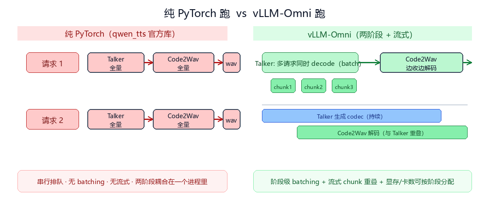
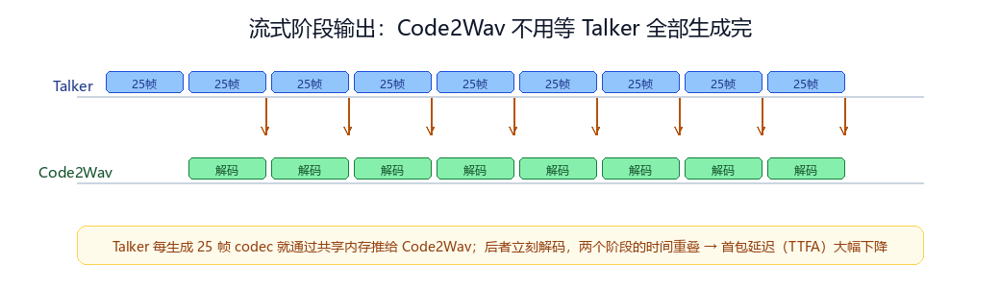

- **vLLM、SGLang等模型服务框架的特点**

  vllm设计想法叫做一种**步骤为中心的方式(step-centric paradigm)**——也就是说整个推理引擎把一步解码作为最基本、唯一的**执行单位与调度单位**

  ```
  一个简单的GPT模型
  
  class MyModel(nn.Module):
      def forward(self, input_ids, past_key_values=None):
          # 一次前向传播，输出 logits + 更新后的 KV Cache
          return logits, new_kv
  ```

  ```
  vllm的简化结构(engine)
  
  Scheduler       决定本轮那些请求(以及哪些token)可以进入batch，统计占用的KV Cache或计算还需要多少KV Cache
      ↓
  Executor        将调度好的任务派发给不同的计算资源，并收集执行结果，如把任务分发给Worker执行并收集worker执行结果
      ↓
  Worker          加载模型权重，管理KV Cache，接受Executor的任务，调用Model Runner执行模型计算
      ↓
  Model Runner    执行“一次” forward + sampling模型前向计算
      ↓
  生成本轮新的 token
      ↓
  逐层返回 Worker → Executor → Scheduler/上层
      ↓
  Scheduler 根据新 token 决定下一轮
  ```

  **循环调用GPT中的foward直到处理结束**，期间vllm框架会把多个请求凑成batch，处理过程中自动管理KV Cache，进行prefill和decode的切换。

  

- **多模态模型结构**

  多模态模型的一个趋势就是把**多种不同的模型组件组合起来**，完成跨模态的理解和生成任务，导致**多模态模型整体的结构越来越复杂**。

  ```
  qwen3-omni模型
                                                  hidden_state             codec token
  text/image/audio/video → Encodes →  Thinker(AR)   →→→→→→→→→  Talker(AR)   →→→→→→→→→    Vocoder(DiT)
                                      30B大模型                 逐token解码                  轻量模型
                                         |                                                   |
                                        text                                                audio
  ```
  
  qwen3-omni有Thinker、Talker和Vocoder三个stage串成一条多阶段流水线，每一个stage都有自己的forward，还需要管理stage之间的的数据传递。
  
  而一方面，vllm主要是**一步步计算，不区分stage**，没有办法处理“先跑阶段A，再跑阶段B”这种多阶段的流水线，也就是不知道各个模型如何**接力完成任务**(coordinated execution)；
  
  另一方面，像qwen3-omni Talker的每一步decoder、**每一次迭代都需要重复注入Thinker的hidden_state**，vllm的数据处理是请求级的，**中间的东西如hidden_state,、中间的tensor都不出框架**，就没有办法处理不同stage之间的数据流(data flow across multiple heterogeneous stages)。


- **手动连接不同stage**

  从Thinker手动取出hidden_state，手动做数据变换，再手动喂给Talker，就离开了框架，continuous batching、chunked prefill等复杂的优化用不上。

  手动实现通常把Thinker、Talker和Vocode写成一些整体程序(monolithic program)，就会挤在一个进程、一块GPU，资源不可以按需分配，流水线不可以动态调整。


- **vllm-omni的解决方案**

  - 引入**阶段图 Stage Graph**，把整个多模态大模型看成这一张图

    - **节点 = 一个模型阶段(AR、DiT都可以)**

      - 每一个阶段可以独立跑在不同的推理引擎上面(AR 阶段用vLLM，DiT阶段用内置的扩展引擎)，这样可以根据计算需要分配显存和算力

      - 引擎内部还是一个循环：

        ```
        Model Runner
        
        while True：
        	batch = Schedule()    # 调度
         	for req in batch:
        		PreProcFn(batch)  # 预处理
        	Forward(batch)        # 前向
        ```

        直接可以继承vLLM引擎并利用它的优化

    - **边   = 阶段间的数据转换函数 transfer Fn(用户自己写的，用来数据转换和决定把中间数据传到哪一个stage)**

      - 阶段间的数据传递，单机使用共享内存，多机使用TCP/RDMA

    - **编排器(orchestrator) ：管理各个stage的执行和安排收到的请求——也就是管理整张图的推进，到那个stage跑了，数据往那里送。**

  - 引入了阶段图后，将模型接入vllm-Omni需要写好`forward` + `preprocess` + 阶段间的 transfer 函数

  

  

- **官方qwen3-tts与vllm-omni中的qwen3-tts**

  - **官方 `qwen_tts` 库的用法极其简洁：**

    ```python
    # 官方 qwen_tts 库 —— 纯 PyTorch / transformers
    import torch, soundfile as sf
    from qwen_tts import Qwen3TTSModel
    
    model = Qwen3TTSModel.from_pretrained(
        "Qwen/Qwen3-TTS-12Hz-1.7B-CustomVoice",
        device_map="cuda:0",            # 整个模型塞一张卡
        dtype=torch.bfloat16,
        attn_implementation="flash_attention_2",
    )
    
    # 一次调用 = Talker 全部生成完 → Code2Wav 全部解码完 → 才返回 wav
    wavs, sr = model.generate_custom_voice(
        text="其实我真的有发现，我是一个特别善于观察别人情绪的人。",
        language="Chinese",
        speaker="Vivian",
        instruct="用特别愤怒的语气说",
    )
    sf.write("out.wav", wavs[0], sr)
    ```

    这段代码**完全正确、能跑**，问题不在"能不能跑"，而在"跑得好不好"：

    

    | 痛点           | 具体表现                                                     |
    | -------------- | ------------------------------------------------------------ |
    | **串行排队**   | 多个请求只能一个跑完再跑下一个（或一次性静态 batch），请求不能随时进出 |
    | **没有流式**   | 必须等整段音频合成完才能拿到结果，首包延迟高                 |
    | **两阶段耦合** | Talker 和 Code2Wav 共用同一份显存、同一张卡，没法给瓶颈阶段单独加资源 |
    | **优化有限**   | 依赖 transformers 的基础实现，拿不到 continuous batching、CUDA Graph、PagedAttention 这些"大厂级"优化 |

    

  - **vLLM-Omni 的做法是：不写过程式的"先跑 A 再跑 B"，而是声明一张图——节点是阶段，边是阶段间的数据转换。Qwen3-TTS 的图就定义在 `pipeline.py` （`vllm_omni/model_executor/models/qwen3_tts/pipeline.py`）：**

    ```python
    QWEN3_TTS_PIPELINE = PipelineConfig(
        model_type="qwen3_tts",
        stages=(
            # ---------- 节点 0：Talker ----------
            StagePipelineConfig(
                stage_id=0,
                model_stage="qwen3_tts",
                execution_type=StageExecutionType.LLM_AR,   # 自回归：逐帧采样 codec
                input_sources=(),                           # 没有上游，是流水线起点
                owns_tokenizer=True,                        # 自己持有 tokenizer
                engine_output_type="latent",                # 输出是中间 codec，不是最终产物
                # 边（流式）：Talker 每生成一点就往 Code2Wav 推
                async_chunk_process_next_stage_input_func=
                    f"{_PROC}.talker2code2wav_async_chunk",
                # 边（全量兜底）：非流式模式下一次性传完整 codec
                custom_process_next_stage_input_func=
                    f"{_PROC}.talker2code2wav_full_payload",
                sampling_constraints={"stop_token_ids": [2150]},  # codec 的结束标记
            ),
            # ---------- 节点 1：Code2Wav ----------
            StagePipelineConfig(
                stage_id=1,
                model_stage="code2wav",
                execution_type=StageExecutionType.LLM_GENERATION,  # 直接生成音频，不采样 token
                input_sources=(0,),                           # 上游是节点 0
                model_arch="Qwen3TTSCode2Wav",
                final_output=True,
                final_output_type="audio",                    # 最终产物：音频
                requires_full_payload_input=True,
            ),
        ),
    )
    ```

    这里**没有任何"调度循环"或"for 循环"**——顺序、数据怎么流、谁先谁后，全由这张图的 `input_sources` 和边上的函数决定。框架拿到图之后，自动为每个节点起一个独立引擎。

  

  - **Stage Graph 抽象下，模型开发者主要需要提供三样东西。**

    **1. `forward`：每个阶段内部还是"只写一次前向"**（`qwen3_tts_talker.py`）：

    ```python
    class Qwen3TTSTalkerForConditionalGeneration(nn.Module):
        def forward(self, input_ids, positions, intermediate_tensors=None,
                    inputs_embeds=None, **_):
            # 只做"一次"前向：算出下一帧 codec 对应的 hidden states
            # 逐帧循环、KV Cache 管理、请求 batching —— 全由 vLLM 引擎负责
            return self.model(input_ids, positions, intermediate_tensors, inputs_embeds)
    
        def compute_logits(self, hidden_states, sampling_metadata=None):
            logits = self.logits_processor(self.lm_head, hidden_states)
            # 关键：只允许在 codec 词表范围内采样，把 text/特殊 token 全部屏蔽
            return logits.masked_fill(self._codec_disallowed_mask, float("-inf"))
    ```
    
    而 Code2Wav 的 `compute_logits` 直接返回 `None`（`qwen3_tts_code2wav.py`）：

    ```python
    def compute_logits(self, hidden_states, sampling_metadata=None):
        return None   # Code2Wav 不采样 token：它直接把 codec 解码成音频张量
    ```
    
    这就是 `execution_type=LLM_GENERATION` 的含义——这个阶段不走"采样下一个 token"的套路，而是一次前向直接产出音频。

     **2. 边（transfer 函数）：攒满 25 帧就推一个 chunk**

    数据传输的核心逻辑可以浓缩成(源码 `vllm_omni/model_executor/stage_input_processors/qwen3_tts.py` 的 `talker2code2wav_async_chunk`)：

    ```python
    def talker2code2wav_async_chunk(transfer_manager, multimodal_output, request, is_finished=False):
        # 1) 取出 Talker 这一步刚生成的一帧 codec，存进缓冲区
        frame = _extract_last_frame(multimodal_output)
        if frame is not None and _should_append_async_frame(multimodal_output, frame):
            transfer_manager.code_prompt_token_ids[request_id].append(frame)
    
        length = len(transfer_manager.code_prompt_token_ids[request_id])
        chunk_size = int(cfg.get("codec_chunk_frames", 25))   # 默认 25 帧一个 chunk
    
        # 2) 没攒满 25 帧、请求也没结束 → 先不发，回去让 Talker 继续生成
        if (not is_finished) and length % chunk_size != 0:
            return None
    
        # 3) 攒满了（或已结束）→ 打包成一个 chunk，通过连接器推给 Code2Wav
        window = transfer_manager.code_prompt_token_ids[request_id][-chunk_size:]
        return OmniPayloadStruct(
            codes=CodesStruct(audio=torch.stack(window).transpose(0, 1).reshape(-1)),
            meta=MetaStruct(request_id=request_id, finished=torch.tensor(is_finished)),
        )
    ```
    
    下游不用等上游全部跑完。画成时间线就是：
    
    
    
    *Talker 每攒满 25 帧就推一次，Code2Wav 边收边解码，两阶段时间重叠*
    
    **3.preprocess数据预处理**
    
    Talker 在 `preprocess` 里会用 `prompt_embeds_builder` 把 `additional_information` 里的文本 + 参考音频编码成真正的 embedding，替换掉这些占位 id
  
  
  
  - **关键特性：用部署配置（YAML）**
  
     全在 `vllm_omni/deploy/qwen3_tts.yaml` 里可以看懂资源配置：
  
     ```yaml
     # vllm_omni/deploy/qwen3_tts.yaml（节选 + 注释）
     model_runner: v2
     async_chunk: true          # 开启阶段间流式传输
     
     connectors:
       connector_of_shared_memory:
         name: SharedMemoryConnector      # 同机用共享内存，延迟极低
         extra:
           codec_chunk_frames: 25         # 每攒满 25 帧推一个 chunk
           initial_codec_chunk_frames: 1  # 但第 1 帧先吐出去 → 压低首包延迟
           codec_left_context_frames: 72  # Code2Wav 解码时回看的左上下文帧数
     
     stages:
       - stage_id: 0          # Talker
         gpu_memory_utilization: 0.3     # 这个阶段分多少显存
         max_num_seqs: 64                # 同时调度多少个请求
         max_num_batched_tokens: 512     # 小 batch，压低首包延迟
         devices: "0"
         output_connectors: { to_stage_1: connector_of_shared_memory }
     
       - stage_id: 1          # Code2Wav
         gpu_memory_utilization: 0.3
         max_num_seqs: 64
         max_num_batched_tokens: 65536   # codec prefill 很长（16×帧数），必须开大
         devices: "0"
         input_connectors: { from_stage_0: connector_of_shared_memory }
     ```
  
     几个值得点出来的设计：
  
     | 特性                | 在 Qwen3-TTS 里的体现                                        |
     | ------------------- | ------------------------------------------------------------ |
     | **阶段级资源切分**  | 两个阶段各写各的 `gpu_memory_utilization` / `max_num_seqs` / `devices`，甚至可以分到不同卡。这里两个都在 `"0"`，但显存是**分开预算**的。 |
     | **阶段级 batching** | 每个阶段独立调度：Talker 用 `max_num_batched_tokens=512`（小步快跑降延迟），Code2Wav 用 `65536`（因为 codec 展平后很长）。 |
     | **统一连接器**      | `SharedMemoryConnector` 把"数据怎么传"和"模型逻辑"解耦；换多机部署只需换成 Mooncake/RDMA 连接器，模型代码不动。 |
     | **流式 + 首帧优先** | `initial_codec_chunk_frames: 1` 让第 1 帧音频尽快吐出，之后再回到 25 帧的稳定 chunk——兼顾首包延迟和吞吐。 |
     | **内置优化**        | Talker 默认跑 CUDA Graph；Code2Wav 的 decoder 也有 `enable_cudagraph`（`enforce_eager: false`），把重复的解码形状预编译成图。 |


- **补充内容**

  Stage 描述的是：

  - 这个阶段在pipeline里负责什么；
  - 输入从哪来、输出到哪去，需要多少计算资源、**副本(后端在副本内做执行)**；
  - 用什么stage执行类型，和其他 Stage 怎么通过Orchestrator / OmniConnector连接

   vLLM 是其中一种执行方式，主要对应 AR Stage:

  | 执行类型         | 含义                             | 典型场景        |
  | ---------------- | -------------------------------- | --------------- |
  | `LLM_AR`         | 自回归执行，复用 vLLM            | Thinker、Talker |
  | `LLM_GENERATION` | 非自回归一次性生成，也是复用vLLM | Code2Wav        |
  | `DIFFUSION`      | Diffusion / DiT 执行             | BAGEL、世界模型 |

  - **`LLM_AR` Stage**：**它的每个副本内部的后端运行时**，尽可能复用原生 vLLM，包括 `Scheduler`、`KV Cache`、`Worker`、`Model Runner` 等能力。
  - **`DIFFUSION` Stage**：它的**后端不是原生vLLM自回归后端**，而是参考 vLLM 结构实现的一套独立 Diffusion 推理框架，同样有 `Scheduler`、`Executor`、`Worker`、`Model Runner`(名称统一不变)，并增加 `denoising step`、`Diffusion KV Cache`、`CacheDiT`、`TeaCache` 等 Diffusion 特有能力。
  - **`LLM_GENERATION` Stage**：它的后端也不是传统 vLLM 自回归推理，而是非自回归的一次性生成，典型场景是 `Code2Wav`。code2wav 不是"非 vLLM 引擎"，而是**"vLLM 引擎的非自回归模式"**——它复用 vLLM 的调度、显存管理、cudagraph 等基础设施，但不做逐 token 的 AR 解码，而是按 chunk 批量解码 codec 帧为音频波形
